# Executive AI Portfolio

Field evidence and executive lessons from five months operating a private AI-native engineering lab: agentic systems, governance as code, and what changes for technology leadership.

**Who.** I am a technology executive with 20+ years leading product and engineering organizations, most recently as VP of Engineering for a technology company supporting a $300M+ recurring-revenue business. [LinkedIn](https://www.linkedin.com/in/justinzealand)

**Why.** Reading about AI does not build intuition for how it behaves; operating it does. Before leading an organization through AI adoption, I wanted first-hand evidence of what AI-native engineering actually changes: not what a coding assistant does for one developer, but what happens to architecture, review, governance, reliability, and human attention when AI agents perform most of the implementation.

**What.** From March 2026 I designed and operated a private multi-agent engineering environment in which Claude Code, Codex, OpenClaw, Hermes, and local models performed implementation and delegated work, coordinated through a deterministic control plane, while I acted as product owner and architect: setting objectives, constraints, and acceptance criteria. It ran continuously, accumulated 96 consecutive days of health observations at the time of writing, and was governed by a written charter enforced in code.

**What it produced.** Working products, not demos: an AI chief-of-staff that assembles a daily command brief across mail, calendar, tasks, and system health; a delegated-work engine with Slack-based human approvals and durable run history; a self-healing observability plugin for the agent gateway with automated incident investigation; a guarded email-brief workflow with a send ledger; a local knowledge service with a wiki, an API, and a local-model retrieval evaluation; a multi-model decision-review pipeline; macOS integration servers for Apple and productivity apps; and a handful of personal-domain tools, from a local-first native iOS app to a snapshot-first finance analyzer with gated model use.

**What I learned.** AI-assisted development is not primarily a tooling change. It is an operating-model change. As implementation capacity stops being the constraint, the scarce resources become problem framing, context, decision rights, verification, and human attention. The system I built made me the bottleneck before it made me faster, and the controls I added to make it safe eventually became a bigger problem than the risks they addressed. Both of those failures are documented here on purpose.

<picture>
  <source media="(prefers-color-scheme: dark)" srcset="diagrams/00-operating-model-overview.dark.svg">
  
</picture>

## Three case studies

1. [Designing an AI-native engineering operating model](case-studies/01-operating-model.md) — the target is minimum human coordination per successful objective, not maximum agent activity.
2. [Governing autonomous work without eliminating autonomy](case-studies/02-proportional-governance.md) — governance must be proportional to consequence; code should enforce the few boundaries that matter. Includes the controls I over-built, retired too abruptly, and rebuilt.
3. [Making AI-generated work trustworthy](case-studies/03-trustworthy-ai-work.md) — AI can verify AI, but probabilistic judgment still needs deterministic controls and one accountable owner.

## Scope and limits

This was a private, single-operator laboratory, not a customer-facing production environment. Implementation was intentionally delegated to AI coding agents so that I could test the operating model around them: objective definition, architecture, constraints, orchestration, review, measurement, governance, and intervention. The work produced operating evidence about engineering methods, reliability, governance, and human-agent coordination. It did not measure commercial impact, enterprise-scale adoption, or productivity gains, and none are claimed. Attribution rules, measurement method, and the full claim discipline are in [METHOD.md](METHOD.md).

**Chronology.** 2025: structured study and evaluation of AI systems, economics, architecture, and leadership implications. From 2026-03-27: the sustained engineering operating record described here.

## Evidence

| Exhibit | What it shows |
|---|---|
| [01 Charter and operating contract](exhibits/01-charter-and-operating-contract.md) | Decision rights, hard constraints, and the tripwires that route work to a human |
| [02 Proportional governance](exhibits/02-proportional-governance/) | The policy, the drift investigation, and the dated timeline of the governance failure and correction |
| [03 Review kernel](exhibits/03-review-kernel/) | Second-generation multi-model review: design, state model, and measured acceptance (329 attempts, 98.2% content verdicts, 1.8% harness faults, p50 54s) |
| [04 Governance as code](exhibits/04-governance-as-code/) | Five runtime guards with tests, including the warn-first promotion contract for new controls |
| [05 Overnight orchestrator](exhibits/05-overnight-orchestrator.md) | Bounded nightly detect-and-fix with kill switches, caps, and post-action verification |
| [06 Autonomy gating](exhibits/06-autonomy-gating.md) | Design notes for the autonomous merge lane: attended vs unattended paths, default deny |
| [07 Observability](exhibits/07-observability/) | Model-free alert path, a weekly graded retrospective, and a postmortem |
| [08 Operator attention](exhibits/08-operator-attention.md) | The study of 4,419 prompts / 240 reviewed samples that reframed the whole system |
| [09 Agent boundaries](exhibits/09-agent-boundaries.md) | The always-on agent's standing safety boundaries |

[Field notes](FIELD-NOTES.md) collects the shorter lessons that did not fit a case study.

## How this was made

The lab, and this repository, were produced through human-directed agentic workflows. The interesting question is how the work was specified, constrained, reviewed, measured, and corrected. Precise attribution is in [METHOD.md](METHOD.md).
