# Case Study 1 — Designing an AI-native engineering operating model

**Thesis:** the target is minimum human coordination per successful objective, not maximum agent activity.

## The question

What changes when software implementation is increasingly performed by AI rather than directly by developers?

I wanted to know first-hand, not by asking a model for isolated snippets but by operating a sustained development environment in which AI agents perform implementation across many projects for months.

## Hypothesis

If AI dramatically increases implementation capacity, the human role should move up the abstraction stack. The scarce resource stops being typing and becomes: choosing the right problem, defining objectives and constraints, architecture and decomposition, acceptance criteria, durable context, coordinating parallel work, evaluating results, governing consequential actions, and deciding when human judgment is required.

So I designed the environment to delegate implementation to AI systems, so that what I was testing was the operating model around them, which I designed and controlled.

## What I designed

A private environment spanning Claude Code, Codex, OpenClaw, Hermes, and local models, coordinated through a deterministic control plane and a shared operating contract, and organized around a few capabilities rather than one general-purpose agent:

- **Persistent objectives.** Work is organized around an objective and its success criteria, not a prompt. A deterministic objective manager continues work across sessions, retries bounded failures, replaces workers, survives restarts, and stops when a material human decision is required.
- **Multiple specialized workers, one owner.** Claude Code, Codex, and other runtimes implement, research, review, or advise, while one owner retains accountability for the result.
- **Durable context and organizational memory.** Decisions, plans, failure patterns, operating rules, and lessons persist outside individual model conversations so the system does not relearn the same lessons.
- **A governed lifecycle.** Isolated workspaces, structured plans, review and acceptance gates, durable evidence, controlled delivery.
- **Deterministic control around probabilistic workers.** Models do the work that needs interpretation; conventional software keeps authority over state, permissions, approvals, external actions, and evidence of completion.

<picture>
  <source media="(prefers-color-scheme: dark)" srcset="../diagrams/01-objective-lifecycle.dark.svg">
  
</picture>

## What happened

The environment became a working laboratory rather than a demonstration. Over roughly five months it produced real products that I owned end to end as product owner and architect: an AI chief-of-staff command brief, a delegated-work engine with human approvals, a self-healing observability plugin with automated incident investigation, a guarded email-brief workflow, a local knowledge service with retrieval, a decision-review pipeline, macOS integration servers, a native iOS app, and several personal-domain tools. Multiple runtimes operated through a shared work fabric, persistent services, scheduled workflows, and human-approval mechanisms.

The objective manager demonstrated, in a live campaign, autonomous completion, a human decision delivered through Slack and resumed correctly, bounded retry, worker replacement, restart persistence, failure containment, and terminal evidence.

I also studied the human side. Over 30 days I retained 4,419 operator prompts and manually reviewed 240 samples to understand the coordination burden created by running many AI workers at once (Exhibit 08).

## What failed

More AI capacity did not automatically produce more human leverage.

Parallel agents turned me into the scheduler, message bus, context manager, reviewer, and cleanup crew. The faster the agents worked, the more coordination work they created for the one person who could not be parallelized. The prompt study made this concrete: a large share of all traffic was the system's own review and orchestration chatter, and the human's share was dominated by re-entry, status reconstruction, and lifecycle ceremony rather than product decisions.

That changed my optimization target. The goal is not maximum agent activity. It is **minimum human coordination required per successful objective.**

## What changed

Supervision moved from the session to the objective. The system evolved toward persistent objectives, deterministic routing, explicit decision boundaries, durable context, automated closeout, structured escalation, and evidence-based completion. Cross-session conditions that no single session owned went into a queue that dedupes, self-heals, and digests instead of into prose for me to route by hand.

The human should primarily see outcomes, material decisions, and real exceptions. Not every intermediate step.

## Enterprise implication

The developer role is unlikely simply to disappear, but its center of gravity will move toward problem framing, architecture, decomposition, context engineering, evaluation, integration, and judgment.

The question for engineering leaders is therefore not "which AI coding tool should we buy?" It is "how should our engineering operating model change when implementation capacity is no longer the constraint it used to be?" And the metric to watch is not agent output. It is how much human attention each successful outcome consumes.

## Evidence

- [Exhibit 01](../exhibits/01-charter-and-operating-contract.md) — the charter and operating contract that define decision rights and the continuation authorization.
- [Exhibit 08](../exhibits/08-operator-attention.md) — the operator-attention study: problem baseline, method, findings, and its own correction.
- [Exhibit 05](../exhibits/05-overnight-orchestrator.md) — the nightly detect-and-fix loop that took routine remediation off the human.
- [METHOD.md](../METHOD.md) — what "built" and "operated" mean here.
