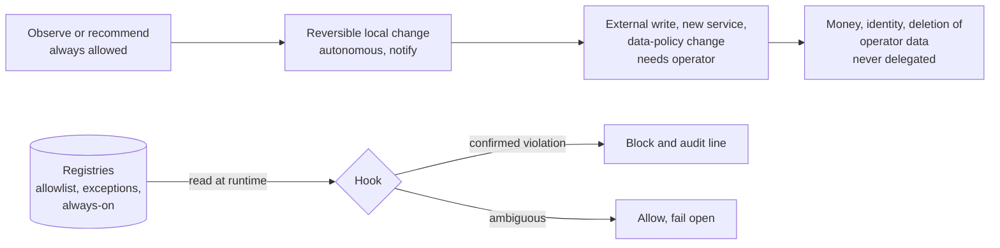

# Case Study 2 — Governing autonomous work without eliminating autonomy

**Thesis:** governance must be proportional to consequence, and code should enforce the small number of boundaries that genuinely matter. This case study includes the controls I over-built, retired too abruptly, and rebuilt.

## The question

How much authority should an AI agent actually have?

An agent that can only recommend creates limited leverage. An agent with unrestricted authority creates unacceptable risk. The useful territory is in between, and it has to be designed.

## Hypothesis

Autonomy should not be binary. Authority should be granted by the consequence of the action, with deterministic controls defining what may proceed automatically, what requires approval, and what should never be delegated. The human governs the boundaries rather than executing every step.

## What I designed

- **Explicit decision rights.** A versioned platform charter defines operating constraints, responsibilities, privacy boundaries, and the situations that require the operator. Plans inherit its constraints; reviewers may not trade them away.
- **Governance as code.** Permission and inventory registries (allowed outbound integrations, granted exceptions, always-on services) are consumed by runtime hooks. A tool call that violates a boundary is blocked mechanically, not by hoping a model remembers a policy written in prose.
- **Human approval at consequence boundaries.** Work proceeds autonomously until it reaches an action that needs authorization; requests reach me remotely, including through Slack, with signed callbacks.
- **Persistent delegated work.** A shared task and workflow system coordinates multiple runtimes with claims, retries, idempotency, persistent state, and explicit terminal outcomes.
- **Graduated unattended operation.** Nightly closeout, backlog processing, monitoring, and memory maintenance run unattended, each with a kill switch, an escalation path, caps, and post-action verification.
- **Controls earn their teeth.** A new control ships advisory-only; it may block only after a soak of at least 20 operator-adjudicated flags over at least 14 days with a false-positive rate at or below 5%. The gate never scores itself.

## What happened

The delegated-work environment accumulated more than 15,000 internal task records across runtimes (most of it machine-generated review, fan-out, and retries, not 15,000 human tasks). Scheduled workflows ran thousands of times. Heterogeneous workers operated behind one control plane with a single accountable owner.

And then the governance itself failed, in a way I did not expect.

## What failed

**Safe autonomy advanced more slowly than raw capability.** Given the chance to act, well-designed controls frequently made the system escalate rather than act. That looked like a limitation. It was evidence the model was working.

**Prose policy was insufficient.** Rules that lived only in documentation drifted and were interpreted differently across models and sessions. Hence a principle I now apply everywhere: **code binds; prose guides.** Where a rule matters, name the mechanism that enforces it or admit it depends on human judgment.

**The controls outgrew the operator.** This is the failure worth studying. The plan-review system I built to make autonomous engineering safer worked well enough that I applied it to everything. Within weeks the queue of unreviewed plans grew from 2 to 29 in twelve days; plans were being authored at about 4.3 per day and reviewed at about 2.5. The review nag rate exceeded my willingness to act, so the signal degraded into noise. At one point, the controls I had introduced to make autonomous engineering safer became a larger operational problem than some of the risks they were designed to control.

**I then retired it too abruptly.** In the middle of that pressure, one sentence from me ("plan review is currently defective, so we will not use it moving forward") was written into the agents' instruction files the same day and formalized as policy two weeks later. Four days after that formalization, the redesigned review kernel passed its own frozen acceptance targets. I had thrown out a working control because its predecessor had exhausted me, and there was no goals layer to check a heat-of-the-moment decision against.

## What changed

I moved from "maximum autonomy" and from "review everything" to **proportional autonomy and proportional review.**

- Plans are tiered by consequence. Local plans get no packet and no gate. Significant and consequential plans get the full review, and only those.
- Reviewers verify only the surfaces a plan actually names or affects; they do not demand rollout, rollback, lifecycle, or parity proof for a local read-only tool.
- The review gate was restored for the two upper tiers only, and the kernel reviewed its own restoration plan before it shipped.
- Governance changes are now bound to written project goals, so a future retirement is checked against the same goals its introduction served.

The exhibit for this case study is a dated timeline of the whole arc, with the original decision documents.

## Enterprise implication

Organizations adopting agents need more than an acceptable-use policy. They need an authority architecture: what can AI observe, recommend, change; what requires approval; what requires independent review; what data may leave; what evidence must exist before an action counts as complete; how autonomy is revoked when something goes wrong.

That looks less like prompt engineering and more like identity and access management, production operations, and internal controls. And it has to be proportional: governance that scales with risk, applied by machinery rather than by memory, and reviewed for its own cost with the same rigor as the risks it manages. The companies that succeed with agentic AI will not be the ones that grant the most autonomy, nor the ones with the most controls. They will be the ones that learn where each creates leverage.

## Evidence

- [Exhibit 02](../exhibits/02-proportional-governance/) — the proportional policy, the drift decision, the drift investigation, and the dated timeline of the failure and correction.
- [Exhibit 04](../exhibits/04-governance-as-code/) — five runtime guards with their tests, including the warn-first promotion contract.
- [Exhibit 06](../exhibits/06-autonomy-gating.md) — design notes for the autonomous merge lane: attended vs unattended paths, default deny.
- [Exhibit 09](../exhibits/09-agent-boundaries.md) — the always-on agent's standing boundaries.
