# Case Study 3 — Making AI-generated work trustworthy

**Thesis:** AI can verify AI, but probabilistic judgment still requires deterministic controls and accountable ownership. Observability is not control.

## The question

If AI produces more of the work, how do we know the work is actually good?

Human review does not scale with AI output. But asking another model "does this look correct?" replaces one probabilistic judgment with another. I wanted to know whether AI review could become an engineered, measurable capability.

## Hypothesis

AI can participate heavily in quality assurance, but trust cannot rest on model confidence. A reliable system needs independent review, deterministic validation, measurable reliability, and human authorization proportional to consequence.

## What I designed

A multi-model review system in which independent AI reviewers evaluate plans and consequential work before implementation or authorization. The first version was instrumented so I could tell apart a problem with the work, a problem with a reviewer, and a failure of the review infrastructure itself.

Around it, observability for the whole environment: deterministic daily health checks, model-independent alerting, automated incident investigation with budgets, false-positive tracking, post-action verification, weekly graded operational retrospectives, and explicit acceptance criteria for important systems.

<picture>
  <source media="(prefers-color-scheme: dark)" srcset="../diagrams/03-three-layer-trust-model.dark.svg">
  
</picture>

## What happened

The first review architecture processed roughly 1,700 review packets. The surprising result: most failures were not failures of AI reasoning. An architecture review found that 64% of blocked outcomes were caused by the harness around the models (state handling, orchestration, bookkeeping, authorization), and only 73–85% of passes ended in a content verdict at all.

That drove a redesign. The second-generation kernel moved responsibility into a small deterministic core (content-addressed frozen packets, an append-only event log with a checksum chain, an explicit state machine, admission control) and constrained model outputs to structured, validated responses. It was then held to targets frozen in advance. In its acceptance window it reached a content verdict on 97.6% of 211 attempts at a median of 54 seconds with a 2.4% harness-fault rate. Cumulatively, as of this writing: 600 attempts, 98.5% content verdicts, 1.5% harness faults, p50 56s, p95 114s.

Those figures describe a private experimental environment, not enterprise service levels. Their importance is that they were measured against explicit acceptance criteria rather than inferred from successful demos.

## What failed

The monitoring environment produced the more useful lesson. It was very good at detecting problems and much worse at remediating them. For much of the measured period the platform reported its own health as red, but investigation showed that the health signal itself was not consistently trustworthy: some reds were false positives from checks that graded a stale proxy instead of the live system, and at least one green was a false negative produced by a model summarizing the report. Some automated repair processes became sources of failure themselves. **Observability is not control.** Detection without effective remediation is a more sophisticated way of overwhelming the human operator.

Two specific failures shaped the design:

- A model-mediated alert path once mis-graded a non-green health report as a recovery. The fix was structural: the decision to send an alert now runs in plain code off the collector's verdict, with no model anywhere in the send path.
- AI reviewers produced false positives with confident, schema-valid output. I added deterministic fact-checks around classes of reviewer claim (for example, a "duplicated implementation" finding is refuted mechanically if both cited files import the same shared module), and I started tracking the suppression rate of the reviewer as a first-class signal: when most findings are suppressed downstream, the detector is the finding.

The lesson is recursive: **AI can verify AI, but the verifier also needs verification.**

## What changed

I separated the system into three layers and kept them separate:

1. **Probabilistic judgment.** Models interpret, synthesize, propose, implement, and review.
2. **Deterministic control.** Software owns state, identity, permissions, schemas, invariants, external actions, and evidence.
3. **Human accountability.** People define objectives and risk tolerance, resolve consequential ambiguity, authorize high-impact actions, and remain accountable for outcomes.

Reliability is an architectural property of the whole sociotechnical system, not a characteristic of the model. The exhibits include a real postmortem in which nothing on the machine would have recovered the outage; I noticed and fixed it by hand, and then built the recovery guard that should have existed.

## Enterprise implication

Enterprise AI governance cannot stop at an approved-model list or a Responsible AI policy. Organizations will need operating mechanisms for evaluation, independent review, deterministic validation, false-positive measurement, observability, incident management, rollback, authorization, and evidence that an AI action produced the intended result.

The question for technology leadership is not "can we trust the model?" It is "can we design a system that remains trustworthy even though the model is probabilistic?"

## Evidence

- [Exhibit 03](../exhibits/03-review-kernel/) — the review kernel's design, state model, and regenerated acceptance metrics with the command that produces them.
- [Exhibit 07](../exhibits/07-observability/) — the model-free alert path and why, a weekly graded ops retrospective, the gateway-outage postmortem, and the watchdog's design rules.
- [Exhibit 04](../exhibits/04-governance-as-code/) — the guards that turn review conclusions into enforced boundaries.
- [METHOD.md](../METHOD.md) — how each metric was produced and what it does not support.
